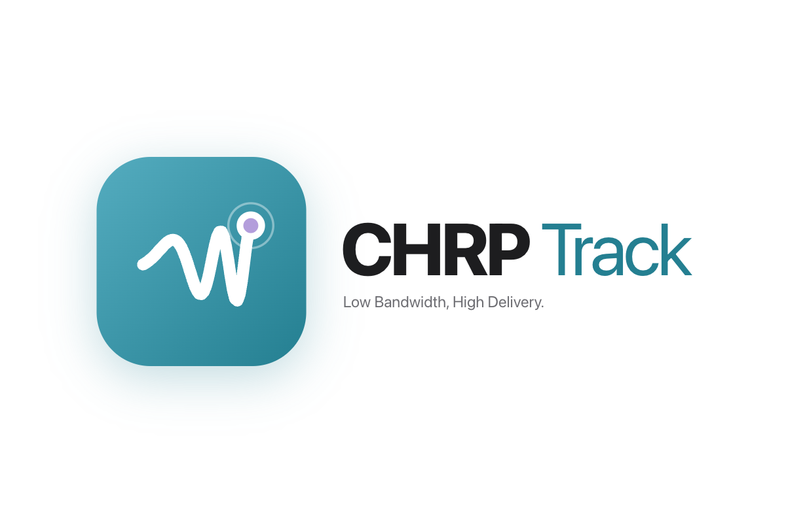

<p align="center">
  
</p>

# SmartMesh

Send text, pictures and voice messages between simulated off-grid mesh radios, with neural compression so they fit in a
handful of tiny packets. Two iPhone-styled screens sit side by side: send from one, watch the packets cross the mesh,
and open what arrives on the other.

```
 phone UI (React)  <-- REST + WebSocket -->  FastAPI backend  <-- TCP -->  6 simulated Meshtastic nodes (Docker)
  Node 0 | Node 5                             compress, chunk,              Meshtasticator + meshtasticd
                                              ACK, resend, decode
```

Built on [Meshtasticator](https://github.com/meshtastic/Meshtasticator), which runs real Meshtastic firmware
(`meshtasticd`) as simulated LoRa nodes in Docker.

## What it does

- **Text, images and voice** from one simulated node to another, through the mesh simulator.
- **Neural image compression** (CompressAI) and **neural voice compression** (EnCodec), with JPEG and "send as recorded"
  as fallbacks you can switch to in the UI.
- **Honest progress:** a packet counts as acknowledged when it reaches the destination node. Missing packets are resent,
  and a transfer is delivered only when every packet arrived and the checksum matches.
- **Twin phones:** the left phone is Node 0, the right phone is Node 5 (changeable). Each has its own screens.
- **Details and route:** open any item to see the image, a voice player or the text, plus the nodes heard relaying it.
- **Live Mesh log:** every chunk, radio transmission, relay, ACK and decode, as it happens.
- **Self-healing:** if the simulator container disappears, the backend starts a fresh one.

## Repository layout

| Path | What it is |
|---|---|
| `chrp-track/frontend/` | The phone UI (React, TypeScript, Vite). Built output goes to `dist/`. |
| `chrp-track/backend/` | FastAPI app: REST, WebSocket, pipeline, codecs, simulator host. |
| `chrp-track/backend/app/mesh.py` | Boots the simulator, sends chunks, tracks ACKs, resends, watches the container. |
| `chrp-track/backend/app/pipeline.py` | Prepares payloads (compress), starts transfers, decodes at the destination. |
| `chrp-track/backend/app/neural.py` | Neural image codec (CompressAI `bmshj2018_factorized`). |
| `chrp-track/backend/app/voice.py` | Neural voice codec (EnCodec 24 kHz). |
| `chrp-track/CONTRACT.md` | The event shape the UI and backend share. |
| `Meshtasticator/` | The mesh simulator. `lib/blob.py` is our chunking and reassembly. |
| `image_compress.py`, `voice_compress.py` | The original standalone codec scripts the app's codecs came from. |
| `ui/` | An earlier, simpler twin-screen page. Superseded by `chrp-track`; do not run it together with the main app. |
| `create_img.py`, `test_2kb.png` | Makes and holds a small test image. |

## Requirements

- **macOS** (developed and tested here). Apple Silicon uses the GPU for image coding; other machines use the CPU.
- **Docker Desktop**, running.
- **Python 3.12** (a virtual environment in `.venv/`) with Tk support, which the simulator's plotting module imports.
- **Internet on first run** to download model weights (about 90 MB for EnCodec; the image model is small).
- Node.js is **not** needed: the UI is built inside a throwaway Docker container.

## Setup

```bash
# 1. Python environment
python3.12 -m venv .venv
source .venv/bin/activate
pip install -r Meshtasticator/requirements.txt
pip install docker
pip install -r chrp-track/backend/requirements.txt

# 2. Build the phone UI once (and again after changing anything in chrp-track/frontend/)
docker run --rm -v "$PWD/chrp-track/frontend":/app -w /app node:20-slim sh -c "npm ci && npm run build"
```

The first start pulls the `meshtastic/meshtasticd` Docker image if you don't have it.

## Run

```bash
source .venv/bin/activate
cd chrp-track/backend
MOCK_MESH=0 python -m uvicorn app.main:app --port 8000
```

Open **http://localhost:8000**. The simulator takes about 30 seconds to boot and the Main screen says so. On a wide
browser window you get two phones; on a narrow one, a single phone.

Without `MOCK_MESH=0` the backend runs a built-in mock mesh instead (no Docker, no real packets), which is handy for
working on the UI alone.

## Using it

1. Pick the nodes on each phone: "You are Node X, sending to Node Y". The swap button flips them.
2. Send something:
   - type in the message box,
   - tap the big dial to pick an image or audio file,
   - or tap **Record a voice message** (up to 8 seconds).
3. Choose compression on Main: **Image** Neural or JPEG, **Voice** EnCodec or Original (and a bitrate of 1.5 to 24 kbps).
4. Watch **Sending now** on the sender and **History** on the receiver. Tap a row to see the content and route.
5. Open the **Log** tab to follow the packets.

The microphone needs `localhost` or HTTPS, so voice recording does not work from a phone over plain `http://<ip>`.

## How compression works

Each payload is compressed, split into chunks of up to 180 bytes (11-byte header: transfer ID, index, total, kind,
CRC32), sent through the mesh, and rebuilt and decoded at the destination.

**Images:** CompressAI `bmshj2018_factorized` at quality 1. The picture is shrunk to at most 256 px, encoded to a
bitstream, and decoded to a PNG at the destination. In our tests a 220x220 image took 503 bytes where a 96 px JPEG took
759. JPEG (96 px, quality 40) is the fallback.

**Voice:** EnCodec 24 kHz mono at 1.5, 3, 6, 12 or 24 kbps. A 7.1 second clip (317 KB as WAV) took 1.4 KB at 1.5 kbps
and 5.4 KB at 6 kbps. The browser converts the recording to a 24 kHz WAV first, because the server can't open WebM or MP4.

Limits and caveats:

- The payload after compression is capped at 12 KB; larger items fail with a clear reason.
- Neural coding is lossy, and image quality 1 is soft. We have not run listening tests, so there are no voice-quality
  numbers yet.
- Timings come from the simulator (1.5 s between chunks), not real LoRa airtime.
- The two image test pictures other than `test_2kb.png` were synthetic, not photos.

## Configuration

Set as environment variables when starting the backend.

| Variable | Default | Purpose |
|---|---|---|
| `MOCK_MESH` | `1` | `0` runs the real simulator, `1` the mock |
| `MESH_LOCAL_NODE`, `MESH_PEER_NODE` | `0`, `5` | Default sender and destination node |
| `MESH_CHUNK_DELAY` | `1.5` | Seconds between chunks. Lower values flood the simulated radios. |
| `MESH_MAX_ROUNDS`, `MESH_ROUND_WAIT` | `4`, `10` | Resend rounds and wait per round |
| `MAX_MESH_BYTES` | 12 KB | Largest payload accepted after compression |
| `IMAGE_CODEC` | `neural` | `neural` or `jpeg` |
| `NEURAL_QUALITY`, `NEURAL_MAX_SIDE` | `1`, `256` | Image codec quality and longest side |
| `IMAGE_MAX_SIDE`, `IMAGE_QUALITY` | `96`, `40` | JPEG fallback size and quality |
| `VOICE_CODEC` | `neural` | `neural` (EnCodec) or `raw` |
| `VOICE_BITRATE` | `6` | Default EnCodec bitrate in kbps |
| `UPLOAD_DIR` | `./data/uploads` | Where uploads and received content are stored |

## Troubleshooting

- **"Timed out waiting for connection completion" / sends fail:** the simulator container is gone. The backend notices
  within seconds and restarts it; tap **Retry** once the notice clears. Don't run `Meshtasticator/send_message.py` or
  the old `ui/` server while this is running: they remove the container named `Meshtastic`.
- **Port 8000 busy or container name conflict:** stop the other server (`pkill -f "uvicorn app.main:app"`), wait a few
  seconds for it to remove its container, then start again.
- **Images fall back to JPEG or voice is sent as is:** the model couldn't load (missing package or no network for the
  first weight download). The Log tab says why.
- **Nothing arrives after many sends:** check the Log tab for "TX queue credit ... restored". The backend works around a
  client-side flow-control leak in the Meshtastic library.
- **Stale page after a rebuild:** hard refresh the browser.

## Status

Developed and tested on macOS with Docker Desktop. The backend was exercised end to end on the real simulator for text,
images, voice, replies in both directions, oversized items, container loss and recovery. The browser UI builds and
typechecks; parts of it, such as the twin-phone layout, the compression pickers and in-browser voice recording, were not
exercised by automated tests. History is held in memory and resets when the backend restarts.
